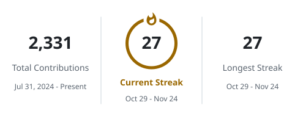

<picture>
  <source media="(prefers-color-scheme: dark)" srcset="header-dark-v5.svg">
  
</picture>

Electronic & Information Engineering at UESTC, Chengdu. I build AI systems end to end: the models, the products around them, and some of the hardware they run on.

<samp><a href="https://sahra.to">sahra</a> · <a href="https://www.linkedin.com/in/mohamed--abdelrahim/">linkedin</a> · <a href="mailto:Mohamedr7825@gmail.com">email</a> · <a href="https://www.eocs.net">eocs</a></samp>

<a href="https://gitranks.com/profile/geno543"><picture><source media="(prefers-color-scheme: dark)" srcset="https://gitranks.com/badge/user/geno543/rank.svg?theme=dark"></picture></a>&nbsp;&nbsp;<samp>#73 in Egypt</samp>

### Now

**[SAHRA](https://sahra.to)** · co-founder and CTO. Table reservations for restaurants in Egypt and MENA, in Arabic and English, pre-launch. I built the Flutter diner and venue apps, the NestJS and PostgreSQL API and the Next.js site. When two people tap the same table in the same second, only one gets it: three layers of guards, about 6,000 automated tests. [Diner](https://sahra-diner-staging.onrender.com) · [Venue](https://sahra-venue-staging.onrender.com)

**AB Robotics** · engineer. We take client projects from idea to working build: AI workflow automations, robots and computer-vision systems. EGP 100,000+ in revenue so far.

### Selected work

**[CALM](https://calm-virid.vercel.app)** · an AI tutor that refuses to give students the answer. A rule-based checker sits between the model and the student and blocks any reply that leaks it. Built with a University of Minnesota PhD researcher; IEEE YESIST12 2026 grand finalist.

**[Malaria API](https://github.com/geno543/Malaria-ai-model)** · upload a blood smear and get the infected cells marked, with a risk report. YOLOv8 plus a custom attention classifier, served with FastAPI.

**[ColiFormer](https://www.mdpi.com/2306-5354/13/1/114)** · I built the training pipelines and GC-content optimization for a transformer that optimizes E. coli codons. Mean codon adaptation index rose from 0.689 to 0.904 across 37,053 genes. Published in *Bioengineering*; I am not on the author list.

**[EOCS](https://www.eocs.net)** · founded Egypt's first computational science olympiad and kept it free. 2,300+ applicants over two seasons, now recognized by the Ministry of Communications and IT.

### Experience

**Fortinet** · AI security research, 2025–26. One of two secondary-school students selected worldwide; built agents for security operations on FortiGate and FortiAnalyzer telemetry. 
**Novomind** · software engineer intern, 2025. Shipped production features in Java (Spring Boot) and Vue.js. 
**Dama Creativ** · AI agent developer, 2025–26. LangChain multi-agent systems for international clients.

### Results

- 1st, Egypt National AI Olympiad 2026 · selected for Egypt's AI Olympiad team
- Gabarti Scholar, Egyptian Olympiad in Informatics · 1 of 7 selected nationwide
- 8th of 700+ teams, Egyptian Collegiate Programming Contest (Teens) 2026
- Global Honorable Mention, NASA Space Apps 2025 · top 60 of 18,800 teams
- 1st overall, BlastOff 2026 · represented Egypt at the EU Contest for Young Scientists

### Stack

<samp>Python · TypeScript · C++ · Java · Dart</samp> 
<samp>PyTorch · OpenCV · LangChain · FastAPI · NestJS · Next.js · Flutter · PostgreSQL · ROS</samp>

 
<picture>
  <source media="(prefers-color-scheme: dark)" srcset="assets/streak-dark.svg">
  
</picture>

