<picture>
  <source media="(prefers-color-scheme: dark)" srcset="header-dark.svg">
  
</picture>

I study Electronic and Information Engineering at UESTC in Chengdu. Most of my time goes into [SAHRA](https://sahra.to), a table reservation platform for restaurants in Egypt and the Middle East, where I am the CTO.

I started building at 12. My father got sick and I had to run his auto repair shop, where the mechanics were decades older than me and did not listen to me. So I wrote a Python script that priced every job from parts, labor time and a fixed margin. Nobody fights a number personally. A few weeks later they were using it themselves.

### Now

At SAHRA I built the diner app, the venue app, the API and the booking engine. The hard part was making it impossible for two people to book the same table when they tap at the same second. About 6,000 automated tests say it holds.

I also build agents for security operations over FortiGate and FortiAnalyzer telemetry, as part of a Fortinet research project.

### Things I built

- [CALM](https://calm-virid.vercel.app), an AI tutor that will not give you the answer. The model kept solving problems for students, so I put a rule-based checker between it and them.
- [Malaria detection API](https://github.com/geno543/Malaria-ai-model). Upload a blood smear image and get the infected cells marked, with a risk report. YOLOv8 plus an attention classifier I wrote.
- [Oppy](https://oppy.community). Tell it what you want to study and it finds scholarships that fit, out of 2,000+ I collected by hand.
- The training pipelines for [ColiFormer](https://www.mdpi.com/2306-5354/13/1/114), a transformer that optimises codons in E. coli. Mean codon adaptation went from 0.689 to 0.904 across 37,053 genes. I am not on the author list.
- An oil-spill detection drone, built from the frame up when I was 16.
- [EOCS](https://www.eocs.net), Egypt's first computational science olympiad. Free for everyone, down to arranging buses so distance never decided who could compete. 2,300+ students applied over two seasons.

### A few results

1st at Egypt's National AI Olympiad 2026. Top 60 of 18,800 teams at NASA Space Apps 2025. 1st in Egypt for Computing at the EU Contest for Young Scientists 2026.

I mostly write Python, TypeScript, C++ and Dart. I have 60+ public repos here. Not all of them are good. I kept building.

Email me at Mohamedr7825@gmail.com or find me on [LinkedIn](https://www.linkedin.com/in/mohamed-ramadan-551a17272/).
